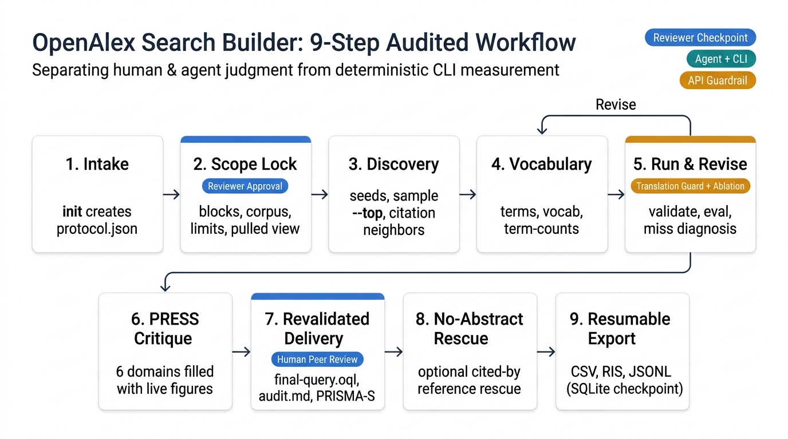
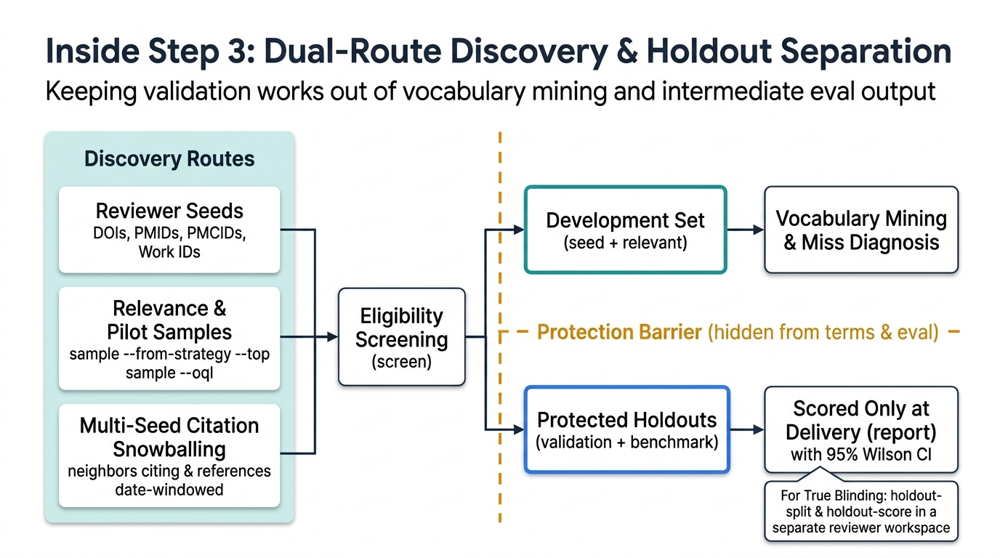
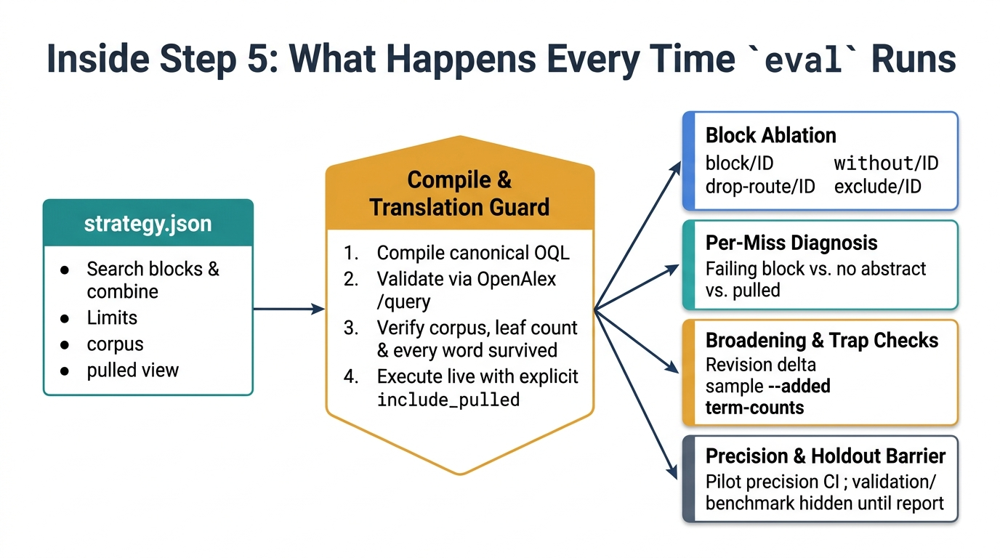
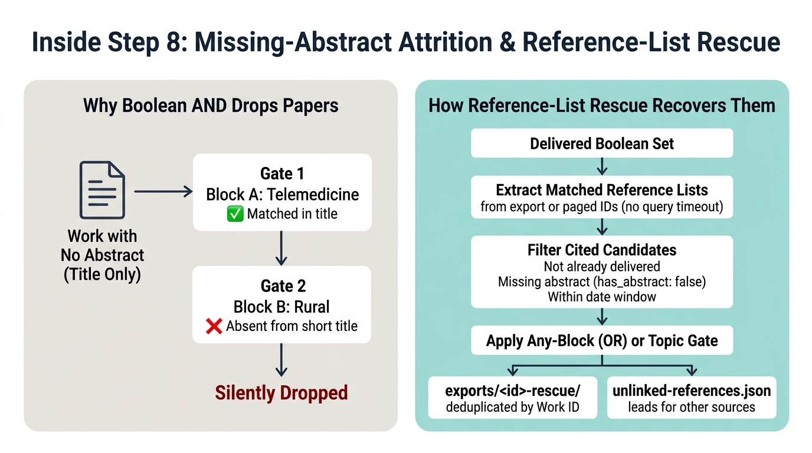

# OpenAlex Search Builder

An agent skill and zero-dependency Python CLI for researchers and librarians developing a **reproducible, high-sensitivity [OpenAlex](https://openalex.org) search strategy** for a systematic, scoping, or rapid review.

Give **Claude Code** or **Codex** your review question and any known seed papers. Instead of guessing a one-shot Boolean query, the agent drives a deterministic Python CLI against the live OpenAlex API to lock scope with you, test every concept block, diagnose missed papers, guard against OpenAlex search traps, and deliver an audited OQL query with a draft **PRISMA-S** checklist and deduplicated **RIS/CSV** export.

> Adapts Aaron Tay's [PubMed Search Builder](https://github.com/aarontaycheehsien/pubmed-search-builder-next) for OpenAlex search execution, field interpretation, work identity, and citation discovery. Requires **Python 3.10+** with **no third-party dependencies**.

---

## How is this different from just prompting an LLM?

Asking ChatGPT or Claude to *"write an OpenAlex search for X"* gives you an unverified string of keywords. This skill separates **search judgment** (you + the agent) from **measurement and guardrails** (the CLI + live OpenAlex API):

| If you just prompt an LLM | With `openalex-search-builder` |
|---|---|
| **Unverified syntax & silent query drops** — LLMs hallucinate OpenAlex syntax or miss cases where OpenAlex accepts a query while silently dropping a corpus flag or clause. | **Compiled & translation-checked** — compiles structured blocks into canonical OQL, validates via `/query`, and fails fast if OpenAlex drops any corpus, term, word, or limit. |
| **Hidden OpenAlex search traps** — bare-word stemming collisions, quoted hyphenated terms running as `AND` instead of phrases, and inconsistent handling of pulled (retracted/withdrawn) works go unnoticed. | **Explicit trap & scope guards** — offline `lint` and live `term-counts` flag stemming and hyphenation traps; `corpus` and `pulled` settings are locked in scope and sent on every request. |
| **Silent loss of abstract-less papers** — ANDing multiple text blocks quietly drops works that lack an indexed abstract in OpenAlex. | **Missing-abstract diagnostics & rescue** — measures missing-abstract attrition per block, supports conditional fallback branches, and offers post-delivery citation `rescue` plus unlinked reference leads. |
| **No empirical feedback or miss diagnosis** — you cannot see what each block costs, which block missed a known paper, or whether broadening actually added eligible studies. | **Live ablation & broadening checks** — measures per-block counts, leave-one-out ablation (`without/ID`), per-miss causes, revision cost warnings (`sample --added`), and exact-query pilot precision. |
| **Overfitting & unverified narratives** — known papers leak into vocabulary mining, and LLM summaries frequently cite stale counts from earlier drafts. | **Protected holdouts & tamper-resistant critique** — keeps validation/benchmark works out of development, reports 95% Wilson intervals, fills critique figures from live evidence, and re-executes at delivery. |
| **Manual copy-paste & no reporting trail** — you still have to document methods, format PRISMA-S items, and export records into screening software by hand. | **Audit bundle & resumable export** — delivers `final-query.oql`, `final-query.json`, `audit.md`, a 16-item draft `prisma-s.json`, and resumable Work-ID-deduplicated CSV, RIS (Zotero/EndNote/Rayyan/Covidence), and JSONL. |

See [**OpenAlex Search Pitfalls**](docs/openalex-pitfalls.md) for the concrete live measurements and edge cases behind each safeguard.

---

## Step-by-step: what happens at each stage



Every run lives in a stateful workspace (`-w runs/<name>`) where every query, screening decision, evaluation, and critique is saved as immutable JSON snapshots tied together by cryptographic fingerprints. You stay in control at the key methodological checkpoints while the CLI enforces measurement and guardrails underneath.

### Step 1 — Intake (`init`)
- **What happens:** You give the agent your review question, eligibility criteria, required limits (such as date range), optional known papers (DOIs, PMIDs, PMCIDs, or OpenAlex Work IDs), and desired depth (`quick`, `standard`, or `thorough`).
- **Under the hood:** `init` creates the workspace and records the protocol in `protocol.json`. If you are updating a previous search, the agent opens the existing workspace and inspects its last delivered report instead of starting over.

### Step 2 — Scope lock (`scope`, `scope --confirm`) — *Reviewer checkpoint*
- **What happens:** The agent proposes a compact concept table assigning each concept a role — `search`, `optional`, `screen`, or `exclude` — and asks you to confirm before running live evaluations. Outcomes, study designs, and open-ended *"any X"* facets are kept at `screen` unless single-concept volume is genuinely unscreenable, so sensitive concepts are not prematurely cut.
- **Under the hood:** You and the agent also lock two OpenAlex-specific scope decisions in `strategy.json`:
  - **`corpus`:** `core` (default), `all` (core plus OpenAlex's expansion corpus), or `expansion`.
  - **`pulled`:** `exclude` (default — retracted, withdrawn, and removed works stay out) or `include`.
- `scope --confirm --note "..."` hashes the approved blocks, roles, protocol, limits, corpus, and `pulled` view into `scope.json`. `eval` refuses to run until scope is approved, and if any of those inputs change later, it stops and names exactly what changed (editing a block's rationale text alone does not trigger re-confirmation).

### Step 3 — Known works, discovery & holdout separation (`resolve`, `sample`, `neighbors`, `screen`)



- **What happens:** Known eligible papers are registered first via `resolve --role seed`. Whenever you have known studies, supplying them is strongly recommended: in seedless runs, discovery reaches only a small corner of the eligible literature, so reviewer seeds remain the most reliable recall check. If enough known papers exist, a subset can be allocated to `validation` (or prior-review included studies to `benchmark`) *before* reading titles or mining vocabulary.
- **Discovery routes (standard & thorough depth):**
  - **Relevance-ordered & pilot text sampling:** `sample --from-strategy --top` screens the draft search's best matches first in OpenAlex relevance order (the most productive way to find development works); `sample --oql` pilots targeted exploratory queries.
  - **Multi-seed citation snowballing:** `neighbors ID ... --direction citing|references` follows OpenAlex's matched reference lists from screened development works, deduplicating and ranking co-linked candidates first. Because OpenAlex links ~82% of references and many older items lack reference lists, the CLI checks each seed's link counts (free) and refuses dead-end seeds before spending paid requests. `neighbors --direction related` returns up to 10 text-similarity neighbors (never reviews or retracted works) and is tracked as a text route rather than citation searching.
  - **Date-window guard:** Both `sample` and `neighbors` automatically apply the strategy's publication-date limits so post-cutoff works (including source reviews in blind benchmarks) do not leak into candidate pools.
- **Screening & protection barrier:** Candidates are judged against your written eligibility criteria via `screen` (`include`, `exclude`, or `unclear`). Included development works go into `relevant`; excluded works are retained so `eval` can measure how many irrelevant works your query still matches. Works marked `validation` or `benchmark` stay hidden from term mining and intermediate `eval` output until final delivery (`report`). For true blinding against filesystem access, the CLI also supports an isolated separate-context reviewer workspace (`holdout-split` / `holdout-score`).

### Step 4 — Vocabulary mining & trap checks (`terms`, `vocab`, `term-counts`)
- **What happens:** The agent builds candidate synonyms, phrases, and spelling variants from the development works (`seed` + `relevant` only — never holdouts) and from OpenAlex's own taxonomy.
- **Under the hood:**
  - `terms` extracts recurring words, bigrams, and OpenAlex keywords from development titles and reconstructed abstracts.
  - `vocab keywords` and `vocab topics` query OpenAlex live for keyword `alternatives` and topic keyword lists. Because OpenAlex keywords and topics are algorithmically assigned labels rather than MeSH headings, there is no controlled-heading explosion — alternatives must be spelled out explicitly.
  - Strategies start on `title-abstract` and pilot `title-abstract-keywords` (or `fulltext`) selectively so you can measure the recall vs. volume tradeoff.
  - When a block's count looks unexpectedly large, `term-counts --block ID` tests each term individually to flag OpenAlex-specific traps — bare words whose stem collides with unrelated common words, and quoted hyphenated terms that OpenAlex executes as an `AND` of their parts rather than a phrase.

### Step 5 — Live validation, evaluation, ablation & revision (`validate`, `eval`, `sample --added`, `sample --from-strategy`)



- **Compile & translation guard:** `validate` and `eval` compile `strategy.json` into canonical OQL, submit it to OpenAlex `/query`, and run `check_translation()` on the returned OpenAlex Query Object (OQO). If OpenAlex silently drops a corpus flag, a term, a word, or a limit value, the CLI fails fast rather than running a weaker query. Every live execution passes `include_pulled` explicitly so known-work recall checks see the exact same works the search returns.
- **Ablation & diagnostics (`eval`):** Each full `eval` executes the final query plus diagnostic lines:
  - **Per-block & leave-one-out ablation:** `block/<id>` (each block alone), `without/<id>` (relaxing a block to see what it costs in known works and volume), `drop-route/<id>` (for `combine` OR branches, showing what each entry route adds), `with/<id>` (testing `optional` blocks), and `exclude/<id>` (showing any known works dropped by a `NOT` block). Use `eval --quick` between revisions to skip ablation lines and save credits, then run a full `eval` before critique.
  - **Per-miss diagnosis (`miss_details`):** For every missed development work, reports the exact failing block(s), title, keywords, whether OpenAlex has an abstract, and whether the work is `pulled`. A `pulled` miss cannot be fixed with vocabulary; a missing-abstract miss flags an indexing gap rather than a missing synonym.
  - **Missing-abstract attrition (`--abstract-stats`):** Measures `% without abstract` for the final query and each search block, flagging when ANDing blocks disproportionately drops abstract-less records — prompting either a conditional `has_abstract: false` fallback branch via `combine` or Step 8 rescue.
  - **Broadening guard & pilot precision:** Every `eval` after the first reports `revision` (count change, development works gained/lost, works per gained hit) and warns `broadening_without_gain` if volume jumps by >20% and >500 works without gaining a development work. The agent then runs `sample --added` to screen *only* the newly added records and keeps the broadening only if it brings in eligible studies. Screening a random sample (`sample --from-strategy --size 20`) gives strict and lenient precision estimates with 95% Wilson intervals and exposes abstract boilerplate collisions (such as CC-BY license footers).

### Step 6 — Tamper-resistant internal PRESS critique (`review`)
- **What happens:** Before delivery, a fresh-context agent (or human reviewer) evaluates the strategy across the six PRESS domains: `scope`, `vocabulary`, `boolean_and_fields`, `limits`, `retrieval`, and `limitations` (see [`examples/critique-template.json`](examples/critique-template.json)).
- **Under the hood:** `review critique.json` refuses to run if the last evaluation was `--quick` (ablation is required) or if the strategy changed since the last `eval`. Instead of letting the agent type numbers from memory, the critique uses live brace placeholders (`{final_count}`, `{development_recall}`, `{development_missed}`, `{pulled_count}`, `{without_abstract_pct}`), which `review` fills directly from the current evaluation — rejecting unknown placeholders, hiding holdout figures, and refusing any critique that quotes a stale count from an earlier revision.

### Step 7 — Live-revalidated delivery (`report`) — *Reviewer checkpoint*
- **What happens:** The agent runs `report` to produce a dated, peer-reviewable package and hands over the query, live hit count, recall with 95% Wilson intervals, precision estimate, misses, pulled-work count, limitations, and draft PRISMA-S checklist.
- **Under the hood:** `report` re-executes the full strategy live against OpenAlex and checks that the live evidence fingerprint still matches the approved critique (if OpenAlex's interpretation or matches changed, it stops and requires a fresh review). It writes an atomic snapshot under `reports/<evaluation-id>/`, reveals holdout (`validation`/`benchmark`) retrieval for the first time, and records which holdouts were shown in `exposure.json` so any later delivery is labelled **`post_exposure`** and scores newly added holdouts separately.

### Step 8 — Optional no-abstract citation rescue (`rescue --estimate`, `rescue`)



- **What happens:** Right after delivery, the agent offers an optional supplementary citation rescue specifically targeting works that lack abstracts in OpenAlex and were dropped by the multi-block Boolean `AND`. `rescue --estimate` shows the expected credit cost first without running anything.
- **Under the hood:** The default `--direction cited-by --method references` reads the delivered works' matched `referenced_works` (reusing a completed primary export if available, or paging the delivered search for IDs and references) rather than embedding the full Boolean query inside an OpenAlex citation-set subquery — avoiding timeouts on large strategies. It filters cited works outside the delivered set that have `has_abstract: false` and fall within the date window, then applies an any-block (`OR`) or `--topic` gate to save a dated ID list. Every rescue also saves **`unlinked-references.json`** (printed reference strings of development works that OpenAlex could not link) as leads for other databases and grey literature. Keep the rescue separate from the primary Boolean search in PRISMA reporting.

### Step 9 — Cost-estimated, resumable export (`export --estimate`, `export`)
- **What happens:** When you are ready to screen records in Zotero, EndNote, Rayyan, or Covidence, the agent runs `export --estimate` (free) to state the total record count, 100-record pages, credits, and estimated USD cost before downloading.
- **Under the hood:** `export` cursor-pages the exact delivered `final-query.json` (and optionally `export --rescue` for Step 8's rescued IDs), checkpointing every page in `checkpoint.sqlite3` and deduplicating by OpenAlex Work ID. It verifies OpenAlex executed the exact query object on every page, escapes spreadsheet-formula-like CSV cells while preserving raw records in JSONL, writes `results.csv`, `results.ris`, `results.jsonl`, and `export-manifest.json` (with SHA-256 hashes and any `count_discrepancy`). If a run hits a budget or `--max-pages` limit, it writes `results.partial.*` and resumes cleanly from the saved cursor when rerun.

---

## What you get

Each delivery under `reports/<evaluation-id>/` produces:

- **`final-query.oql`** — Exact canonical OQL query as executed by OpenAlex.
- **`final-query.json`** — Machine-readable OpenAlex Query Object (OQO) for exact re-execution.
- **`audit.md`** — Human-readable peer-review report containing scope decisions, block counts and leave-one-out ablation, missing-abstract attrition, separate recall tables with 95% Wilson intervals, pilot precision, missed-work causes, revision history, 6-domain PRESS critique, and a **16-item draft PRISMA-S checklist**.
- **`prisma-s.json`** — Machine-readable draft PRISMA-S checklist (Rethlefsen et al., 2021).
- **`validation.json`** — Complete JSON evidence archive.

Running `export` writes deduplicated **`results.csv`**, **`results.ris`** (ready for Zotero, EndNote, Rayyan, or Covidence), **`results.jsonl`**, and **`export-manifest.json`** under `exports/<report-id>/`.

👉 **Browse an illustrative sample delivery right now:** [`examples/sample-report/`](examples/sample-report/) (see [`audit.md`](examples/sample-report/audit.md) and [`final-query.oql`](examples/sample-report/final-query.oql)).

---

## Quickstart (Claude Code & Codex)

### 1. Clone and set your OpenAlex API key

Clone the repository and open the folder in **Claude Code** or **Codex**:

```sh
git clone https://github.com/aarontaycheehsien/openalex-search-builder.git
cd openalex-search-builder
```

Set a free OpenAlex API key in `OPENALEX_API_KEY` ([get a key & auth docs](https://help.openalex.org/api/authentication/); see [`.env.example`](.env.example)):

```sh
# macOS / Linux
export OPENALEX_API_KEY="your-key-here"
```

```powershell
# Windows PowerShell
$env:OPENALEX_API_KEY="your-key-here"
```

> **Typical API cost:** A full interactive search build typically uses about **\$0.07–\$0.15** in OpenAlex credits (block counts, known-work intersections, discovery, and live revalidation). Anonymous calls share a very small daily allowance. Before any large download or rescue, `export --estimate` and `rescue --estimate` report expected credits first.

### 2. Start a session with a prompt recipe

**With known seed papers (recommended when you have 1–5 relevant studies):**
> Read SKILL.md. Develop an OpenAlex search strategy for a scoping review of telemedicine delivery in rural communities (2015–2025). Treat W2618851878 as a seed paper. Use standard depth and discuss the concept blocks with me before running searches.

**Starting from scratch (seedless scoping or rapid review):**
> Read SKILL.md. Build an OpenAlex search strategy from scratch (no seed papers) for: "How do university libraries use generative AI in reference services?" Include empirical studies from 2022 onward. Use standard depth, discover candidate papers via both keyword samples and citations, and confirm the concept blocks with me first.

**Adapting an existing PubMed search (or drafting offline without an API key):**
> Read SKILL.md. Adapt my PubMed search strategy for OpenAlex (watch for MeSH terms that need explicit synonyms since OpenAlex has no controlled-heading explosion). If no `OPENALEX_API_KEY` is set, run in offline draft mode (`lint` and `draft`) so I can review the OQL before running live tests.

---

## Try in 60 seconds without an API key (Offline Draft Mode)

Want to see the CLI compile and lint a strategy before getting an API key? Neither `lint` nor `draft` makes network calls:

```sh
python scripts/oasb.py -w runs/offline-demo init --question "How is telemedicine used in rural communities?"
cp examples/telehealth.json runs/offline-demo/strategy.json
python scripts/oasb.py -w runs/offline-demo lint
python scripts/oasb.py -w runs/offline-demo draft
```

This writes clearly labelled untested files (`draft-query.oql`, `draft-notes.md`, `draft-manifest.json`) under `runs/offline-demo/draft/`. When you add `OPENALEX_API_KEY` later, confirm scope and continue in the same workspace.

---

## Using the CLI directly

With `OPENALEX_API_KEY` set, you can drive the entire workflow yourself from the repository root:

```sh
python scripts/oasb.py -w runs/demo init --question "How is telemedicine used in rural communities?"
cp examples/telehealth.json runs/demo/strategy.json
python scripts/oasb.py -w runs/demo scope
python scripts/oasb.py -w runs/demo scope --confirm --note "Reviewer approved delivery and setting blocks"
python scripts/oasb.py -w runs/demo resolve W2618851878 --role seed --source "Reviewer"
python scripts/oasb.py -w runs/demo validate
python scripts/oasb.py -w runs/demo eval --abstract-stats
```

Edit `runs/demo/strategy.json`, rerun `eval` to compare gained/lost works and `without/<block>` ablation, attach a critique (starting from [`examples/critique-template.json`](examples/critique-template.json)) with `review`, deliver with `report`, and optionally run `rescue` and `export`.

For every subcommand, the `strategy.json` schema (`corpus`, `pulled`, `combine`, proximity, exclusions, conditional no-abstract branches), critique placeholders, holdout workflows, and an annotated session walkthrough, see [**CLI Reference, Schema & Walkthrough**](docs/cli-reference.md).

---

## What this does — and does not — do

> [!IMPORTANT]
> - **Single database:** This tool searches OpenAlex only. Systematic reviews normally require multiple databases, study registries, and grey-literature sources; the draft PRISMA-S checklist marks those items for the reviewer to complete.
> - **Development recall is not absolute recall:** Relative recall on known or discovered works describes only those works (and is always shown with a 95% Wilson score interval). Protected local validation works discovered by the same agent share its blind spots; use [separate-context holdout validation](SKILL.md#separate-context-holdout-validation) when independent blinding is needed.
> - **Internal critique is not formal peer review:** The 6-domain PRESS-structured critique catches mechanical and reporting errors, but does not replace peer review by a human information specialist or librarian.
> - **Live index drift:** OpenAlex metadata, reference links, and pulled status change continuously. A dated `report` records what OpenAlex returned at that timestamp; rerunning later queries the live index.

---

## Benchmarks

The repository includes a **41-fixture evaluation suite** ([`evals/README.md`](evals/README.md)) spanning 12 multidisciplinary OpenAlex-native reviews (software engineering, ecology, climate, education, accessibility, bibliometrics) and 29 PubMed cross-comparison reviews (including 10 held-out `frozen` fixtures). Blind single-agent pilot runs on the OpenAlex-native suite typically cost **\$0.07–\$0.15** in API credits and empirically surfaced both wins (such as post-delivery no-abstract rescue recovering missing-abstract gold misses) and structural limits (such as limited discovery reach in seedless runs, underscoring the value of reviewer-supplied seeds). Full scorecards, Wilson intervals, workload ratios, and caveats are published in [`evals/RESULTS.md`](evals/RESULTS.md).

---

## Documentation & Verification

| Resource | Purpose |
|---|---|
| [`SKILL.md`](SKILL.md) | Agent workflow specification (read by Claude Code / Codex) |
| [`docs/openalex-pitfalls.md`](docs/openalex-pitfalls.md) | Concrete OpenAlex search traps, verified measurements, and CLI safeguards |
| [`docs/cli-reference.md`](docs/cli-reference.md) | All CLI commands, `strategy.json` schema, critique placeholders, and annotated walkthrough |
| [`examples/sample-report/`](examples/sample-report/) | Illustrative delivered `audit.md`, `final-query.oql`, `final-query.json`, and `prisma-s.json` |
| [`examples/`](examples/) | Starter strategies (`telehealth.json`, `telehealth-advanced.json`) and `critique-template.json` |
| [`evals/README.md`](evals/README.md) · [`evals/RESULTS.md`](evals/RESULTS.md) | 41-fixture benchmark harness, blind build protocol, and published results |
| [`ROADMAP.md`](ROADMAP.md) | Implemented fixes, empirical lessons, and prioritized open improvements |

Run the offline test suite (also executed automatically by the **Offline tests** GitHub Actions workflow on every push and PR):

```sh
python -m unittest discover -s tests -v
```

A manual **OpenAlex live checks** workflow runs the live integration smoke test and reference comparators when a repository Actions secret named `OPENALEX_API_KEY` is configured.

[OpenAlex OQL API](https://help.openalex.org/api/oql/) · [OpenAlex systematic reviews](https://help.openalex.org/tutorials/systematic-reviews/) · [Pulled works](https://help.openalex.org/data/works/pulled/) · [License](LICENSE)
