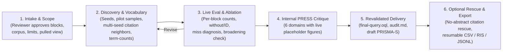

# OpenAlex Search Builder

An agent skill and zero-dependency Python CLI for researchers and librarians developing a **reproducible, high-sensitivity [OpenAlex](https://openalex.org) search strategy** for a systematic, scoping, or rapid review.

Give **Claude Code** or **Codex** your review question and any known seed papers. Instead of guessing a one-shot Boolean query, the agent drives a deterministic Python CLI against the live OpenAlex API to lock scope with you, test every concept block, diagnose missed papers, guard against OpenAlex search traps, and deliver an audited OQL query with a draft **PRISMA-S** checklist and deduplicated **RIS/CSV** export.

> Adapts Aaron Tay's [PubMed Search Builder](https://github.com/aarontaycheehsien/pubmed-search-builder-next) for OpenAlex search execution, field interpretation, work identity, and citation discovery. Requires **Python 3.10+** with **no third-party dependencies**.

---

## How is this different from just prompting an LLM?

Asking ChatGPT or Claude to *"write an OpenAlex search for X"* gives you an unverified string of keywords. This skill separates **search judgment** (you + the agent) from **measurement and guardrails** (the CLI + live OpenAlex API):

| If you just prompt an LLM | With `openalex-search-builder` |
|---|---|
| **Unverified syntax & silent query drops** — LLMs hallucinate OpenAlex syntax or miss cases where OpenAlex accepts a query while silently dropping a corpus flag or clause. | **Compiled & translation-checked** — compiles structured blocks into canonical OQL, validates via `/query`, and fails fast if OpenAlex drops any corpus, term, word, or limit. |
| **Hidden OpenAlex search traps** — bare-word stemming collisions, quoted hyphenated terms running as `AND` instead of phrases, and inconsistent handling of pulled (retracted/withdrawn) works go unnoticed. | **Explicit trap & scope guards** — offline `lint` and live `term-counts` flag stemming and hyphenation traps; `corpus` and `pulled` settings are locked in scope and sent on every request. |
| **Silent loss of abstract-less papers** — ANDing multiple text blocks quietly drops works that lack an indexed abstract in OpenAlex. | **Missing-abstract diagnostics & rescue** — measures missing-abstract attrition per block, supports conditional fallback branches, and offers post-delivery citation `rescue` plus unlinked reference leads. |
| **No empirical feedback or miss diagnosis** — you cannot see what each block costs, which block missed a known paper, or whether broadening actually added eligible studies. | **Live ablation & broadening checks** — measures per-block counts, leave-one-out ablation (`without/ID`), per-miss causes, revision cost warnings (`sample --added`), and exact-query pilot precision. |
| **Overfitting & unverified narratives** — known papers leak into vocabulary mining, and LLM summaries frequently cite stale counts from earlier drafts. | **Protected holdouts & tamper-resistant critique** — keeps validation/benchmark works out of development, reports 95% Wilson intervals, fills critique figures from live evidence, and re-executes at delivery. |
| **Manual copy-paste & no reporting trail** — you still have to document methods, format PRISMA-S items, and export records into screening software by hand. | **Audit bundle & resumable export** — delivers `final-query.oql`, `final-query.json`, `audit.md`, a 16-item draft `prisma-s.json`, and resumable Work-ID-deduplicated CSV, RIS (Zotero/EndNote/Rayyan/Covidence), and JSONL. |

See [**OpenAlex Search Pitfalls**](docs/openalex-pitfalls.md) for the concrete live measurements and edge cases behind each safeguard.

---

## How the workflow runs



Every run lives in an auditable workspace (`-w runs/<name>`). You remain in control at the key methodological checkpoints: approving the concept scope before evaluation, reviewing the delivered audit and draft PRISMA-S checklist, and deciding whether to run the optional no-abstract citation rescue and full record export.

---

## What you get

Each delivery under `reports/<evaluation-id>/` produces:

- **`final-query.oql`** — Exact canonical OQL query as executed by OpenAlex.
- **`final-query.json`** — Machine-readable OpenAlex Query Object (OQO) for exact re-execution.
- **`audit.md`** — Human-readable peer-review report containing scope decisions, block counts and leave-one-out ablation, missing-abstract attrition, separate recall tables with 95% Wilson intervals, pilot precision, missed-work causes, revision history, 6-domain PRESS critique, and a **16-item draft PRISMA-S checklist**.
- **`prisma-s.json`** — Machine-readable draft PRISMA-S checklist (Rethlefsen et al., 2021).
- **`validation.json`** — Complete JSON evidence archive.

Running `export` writes deduplicated **`results.csv`**, **`results.ris`** (ready for Zotero, EndNote, Rayyan, or Covidence), **`results.jsonl`**, and **`export-manifest.json`** under `exports/<report-id>/`.

👉 **Browse an illustrative sample delivery right now:** [`examples/sample-report/`](examples/sample-report/) (see [`audit.md`](examples/sample-report/audit.md) and [`final-query.oql`](examples/sample-report/final-query.oql)).

---

## Quickstart (Claude Code & Codex)

### 1. Clone and set your OpenAlex API key

Clone the repository and open the folder in **Claude Code** or **Codex**:

```sh
git clone https://github.com/aarontaycheehsien/openalex-search-builder.git
cd openalex-search-builder
```

Set a free OpenAlex API key in `OPENALEX_API_KEY` ([get a key & auth docs](https://help.openalex.org/api/authentication/); see [`.env.example`](.env.example)):

```sh
# macOS / Linux
export OPENALEX_API_KEY="your-key-here"
```

```powershell
# Windows PowerShell
$env:OPENALEX_API_KEY="your-key-here"
```

> **Typical API cost:** A full interactive search build typically uses about **\$0.07–\$0.15** in OpenAlex credits (block counts, known-work intersections, discovery, and live revalidation). Anonymous calls share a very small daily allowance. Before any large download or rescue, `export --estimate` and `rescue --estimate` report expected credits first.

### 2. Start a session with a prompt recipe

**With known seed papers (recommended when you have 1–5 relevant studies):**
> Read SKILL.md. Develop an OpenAlex search strategy for a scoping review of telemedicine delivery in rural communities (2015–2025). Treat W2618851878 as a seed paper. Use standard depth and discuss the concept blocks with me before running searches.

**Starting from scratch (seedless scoping or rapid review):**
> Read SKILL.md. Build an OpenAlex search strategy from scratch (no seed papers) for: "How do university libraries use generative AI in reference services?" Include empirical studies from 2022 onward. Use standard depth, discover candidate papers via both keyword samples and citations, and confirm the concept blocks with me first.

**Adapting an existing PubMed search (or drafting offline without an API key):**
> Read SKILL.md. Adapt my PubMed search strategy for OpenAlex (watch for MeSH terms that need explicit synonyms since OpenAlex has no controlled-heading explosion). If no `OPENALEX_API_KEY` is set, run in offline draft mode (`lint` and `draft`) so I can review the OQL before running live tests.

---

## Try in 60 seconds without an API key (Offline Draft Mode)

Want to see the CLI compile and lint a strategy before getting an API key? Neither `lint` nor `draft` makes network calls:

```sh
python scripts/oasb.py -w runs/offline-demo init --question "How is telemedicine used in rural communities?"
cp examples/telehealth.json runs/offline-demo/strategy.json
python scripts/oasb.py -w runs/offline-demo lint
python scripts/oasb.py -w runs/offline-demo draft
```

This writes clearly labelled untested files (`draft-query.oql`, `draft-notes.md`, `draft-manifest.json`) under `runs/offline-demo/draft/`. When you add `OPENALEX_API_KEY` later, confirm scope and continue in the same workspace.

---

## Using the CLI directly

With `OPENALEX_API_KEY` set, you can drive the entire workflow yourself from the repository root:

```sh
python scripts/oasb.py -w runs/demo init --question "How is telemedicine used in rural communities?"
cp examples/telehealth.json runs/demo/strategy.json
python scripts/oasb.py -w runs/demo scope
python scripts/oasb.py -w runs/demo scope --confirm --note "Reviewer approved delivery and setting blocks"
python scripts/oasb.py -w runs/demo resolve W2618851878 --role seed --source "Reviewer"
python scripts/oasb.py -w runs/demo validate
python scripts/oasb.py -w runs/demo eval --abstract-stats
```

Edit `runs/demo/strategy.json`, rerun `eval` to compare gained/lost works and `without/<block>` ablation, attach a critique (starting from [`examples/critique-template.json`](examples/critique-template.json)) with `review`, deliver with `report`, and optionally run `rescue` and `export`.

For every subcommand, the `strategy.json` schema (`corpus`, `pulled`, `combine`, proximity, exclusions, conditional no-abstract branches), critique placeholders, holdout workflows, and an annotated session walkthrough, see [**CLI Reference, Schema & Walkthrough**](docs/cli-reference.md).

---

## What this does — and does not — do

> [!IMPORTANT]
> - **Single database:** This tool searches OpenAlex only. Systematic reviews normally require multiple databases, study registries, and grey-literature sources; the draft PRISMA-S checklist marks those items for the reviewer to complete.
> - **Development recall is not absolute recall:** Relative recall on known or discovered works describes only those works (and is always shown with a 95% Wilson score interval). Protected local validation works discovered by the same agent share its blind spots; use [separate-context holdout validation](SKILL.md#separate-context-holdout-validation) when independent blinding is needed.
> - **Internal critique is not formal peer review:** The 6-domain PRESS-structured critique catches mechanical and reporting errors, but does not replace peer review by a human information specialist or librarian.
> - **Live index drift:** OpenAlex metadata, reference links, and pulled status change continuously. A dated `report` records what OpenAlex returned at that timestamp; rerunning later queries the live index.

---

## Benchmarks

The repository includes a **41-fixture evaluation suite** ([`evals/README.md`](evals/README.md)) spanning 12 multidisciplinary OpenAlex-native reviews (software engineering, ecology, climate, education, accessibility, bibliometrics) and 29 PubMed cross-comparison reviews (including 10 held-out `frozen` fixtures). Blind single-agent pilot runs on the OpenAlex-native suite typically cost **\$0.07–\$0.15** in API credits and empirically surfaced both wins (such as post-delivery no-abstract rescue recovering missing-abstract gold misses) and structural limits (such as limited discovery reach in seedless runs, underscoring the value of reviewer-supplied seeds). Full scorecards, Wilson intervals, workload ratios, and caveats are published in [`evals/RESULTS.md`](evals/RESULTS.md).

---

## Documentation & Verification

| Resource | Purpose |
|---|---|
| [`SKILL.md`](SKILL.md) | Agent workflow specification (read by Claude Code / Codex) |
| [`docs/openalex-pitfalls.md`](docs/openalex-pitfalls.md) | Concrete OpenAlex search traps, verified measurements, and CLI safeguards |
| [`docs/cli-reference.md`](docs/cli-reference.md) | All CLI commands, `strategy.json` schema, critique placeholders, and annotated walkthrough |
| [`examples/sample-report/`](examples/sample-report/) | Illustrative delivered `audit.md`, `final-query.oql`, `final-query.json`, and `prisma-s.json` |
| [`examples/`](examples/) | Starter strategies (`telehealth.json`, `telehealth-advanced.json`) and `critique-template.json` |
| [`evals/README.md`](evals/README.md) · [`evals/RESULTS.md`](evals/RESULTS.md) | 41-fixture benchmark harness, blind build protocol, and published results |
| [`ROADMAP.md`](ROADMAP.md) | Implemented fixes, empirical lessons, and prioritized open improvements |

Run the offline test suite (also executed automatically by the **Offline tests** GitHub Actions workflow on every push and PR):

```sh
python -m unittest discover -s tests -v
```

A manual **OpenAlex live checks** workflow runs the live integration smoke test and reference comparators when a repository Actions secret named `OPENALEX_API_KEY` is configured.

[OpenAlex OQL API](https://help.openalex.org/api/oql/) · [OpenAlex systematic reviews](https://help.openalex.org/tutorials/systematic-reviews/) · [Pulled works](https://help.openalex.org/data/works/pulled/) · [License](LICENSE)
